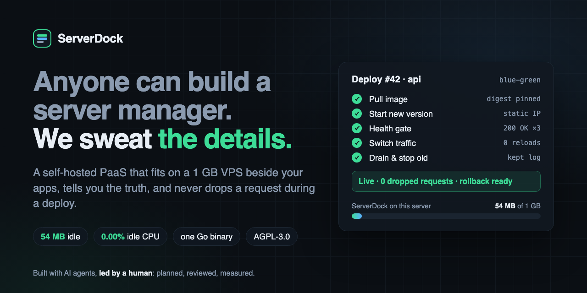
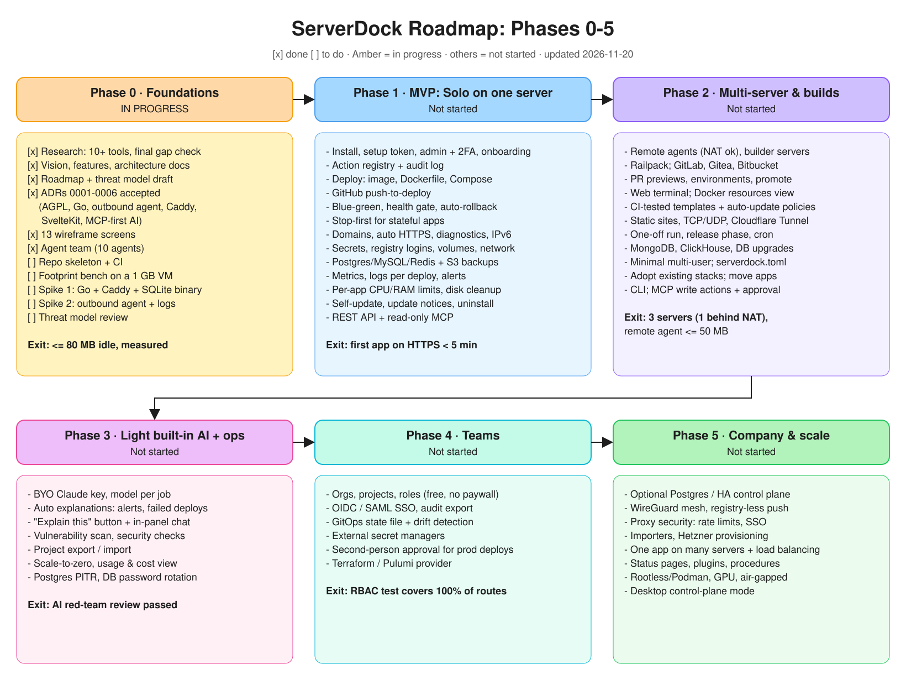

<p align="center">
  
</p>

<p align="center">
  <a href="LICENSE"></a>
  
  
  
</p>

# ServerDock

**Anyone can build a server manager. Few sweat the details.**

There are plenty of self-hosted panels, and today an AI can write a new one over a weekend. What is still rare is the care: what happens when a deploy fails at 2 a.m., whether the panel tells you the truth or a hopeful guess, whether it fits on the small server you actually pay for, and whether you can use it from your phone or with a screen reader.

ServerDock is a self-hosted PaaS and server manager built around those details. It runs on a **1 GB VPS beside your apps**.

> **Status: pre-release.** Phase 1 is in progress. Deploying from an image is built and tested; there is no install script yet. The early usable version arrives with milestone M7a. See [what works today](#what-works-today).

## The details we care about

| | What it means | Evidence |
|---|---|---|
| **Light** | The panel, agent and proxy idle at about **54 MB RAM and 0.00% CPU**. Popular panels idle at 0.7–1.2 GB. | CI bench on every change; [research/01](docs/research/01-coolify-dokploy.md), [research/05](docs/research/05-phase0-measurements.md) |
| **No dropped requests** | Blue-green deploys switch traffic without reloading the proxy. A failing new version never takes traffic. | 0 failed requests and 0 proxy reloads across repeated switches under load |
| **Crash-safe** | Kill ServerDock at any of 20 deploy stages and it comes back to a correct state: finished, rolled back, or cleaned up. | `kill -9` test at every blue-green and stop-first stage |
| **Honest** | The UI says `unknown` when it doesn't know, and never reports success before the work is done. Failures come with evidence and a next step. | Rule in [CLAUDE.md](CLAUDE.md); checked in review |
| **Safe** | Typed Docker API calls, never shell strings. 2FA for dangerous actions, an audit log, secrets kept out of logs. | [Threat model](docs/security.md) |
| **Usable** | Works on a phone, at 200% zoom, in dark mode, with forced colours and with a keyboard only. | Zero axe violations in 8 Playwright projects; manual screen-reader passes |
| **Simple** | One Go binary, SQLite inside. No Redis, no Swarm, no Kubernetes. | [Architecture](docs/architecture.md) |
| **Open** | AGPL-3.0, team features included, no telemetry. | [LICENSE](LICENSE) |

## Built with AI, led by a human

AI can build almost anything you ask for. Getting the *right* thing still needs someone to set the goals, check the work and say no.

ServerDock is written by AI agents under one maintainer's direction, and every change follows the same path:

```
idea → plan → plan review → build → tests → reviews by specialists → maintainer decides → merge
```

- **Plans first.** Each milestone has a written plan in [docs/plans/](docs/plans/) with steps, tests and a memory budget.
- **Specialist reviewers.** Separate agents review security, distributed-system failure modes, memory footprint and accessibility. A change merges only when the required ones approve.
- **Measured, not claimed.** Memory and CPU are benchmarked in CI on every change, against published ceilings.
- **The maintainer decides.** Trade-offs, accepted risks and merges are the maintainer's call, and they are recorded in the plans.

The agents and their roles are in [CLAUDE.md](CLAUDE.md) and [.claude/agents/](.claude/agents/).

## What works today

Built and tested in milestones M1 to M3a:

- **First run over HTTPS**: setup token, admin account with TOTP and recovery codes, sessions, and API tokens that must expire.
- **Deploy from a container image**: blue-green or stop-first, a health gate, automatic rollback when the health check fails, one-click rollback to an earlier deploy, redeploy and restart.
- **Public ports** through the embedded Caddy proxy, switched without a reload.
- **Recovery after crashes**: a reconciler that settles interrupted deploys and cleans up leftover containers.
- **Deploy logs and live progress**, with terminal-control characters removed.
- **Delete** that needs fresh 2FA and the service name typed out.
- **REST API** with an [OpenAPI document](docs/api/openapi.json), and an audit log of every action.
- **A web UI** that works on desktop and phone.

## What's next

The next steps lead to an **early usable version**: env vars and secrets, volumes and private registries (M3b), then domains with automatic HTTPS (M4a), then the install script and signed releases (M7a). After that come self-update, git builds and push-to-deploy, Compose, databases with backups, passkeys, monitoring, and a read-only MCP endpoint for Claude and other AI clients.



Order and exit checks: [docs/roadmap.md](docs/roadmap.md).

## Build from source

Running it is for contributors only until the install script lands.

```sh
make web     # build the web UI (needs Node; see web/.nvmrc)
make build   # build the binary with the UI embedded
make test    # run the tests
```

See [CONTRIBUTING.md](CONTRIBUTING.md) for the full setup.

## Docs

| Doc | What's in it |
|---|---|
| [Vision](docs/vision.md) | Problem, promise, audience, non-goals |
| [Features](docs/features.md) | Full feature list by phase |
| [Architecture](docs/architecture.md) | Design, key decisions, footprint budget |
| [Roadmap](docs/roadmap.md) | Phases, milestones and exit checks |
| [Security](docs/security.md) | Threat model, rules and accepted risks |
| [UI](docs/ui.md) · [Wireframes](docs/wireframes/README.md) | Screens and UI principles |
| [Plans](docs/plans/) · [Decisions](docs/decisions/) | Milestone plans and ADRs |
| [Research](docs/research/) | Other tools, measurements and options |

## Contributing

See [CONTRIBUTING.md](CONTRIBUTING.md). Report vulnerabilities privately as described in [SECURITY.md](SECURITY.md).

## License

[AGPL-3.0](LICENSE)
