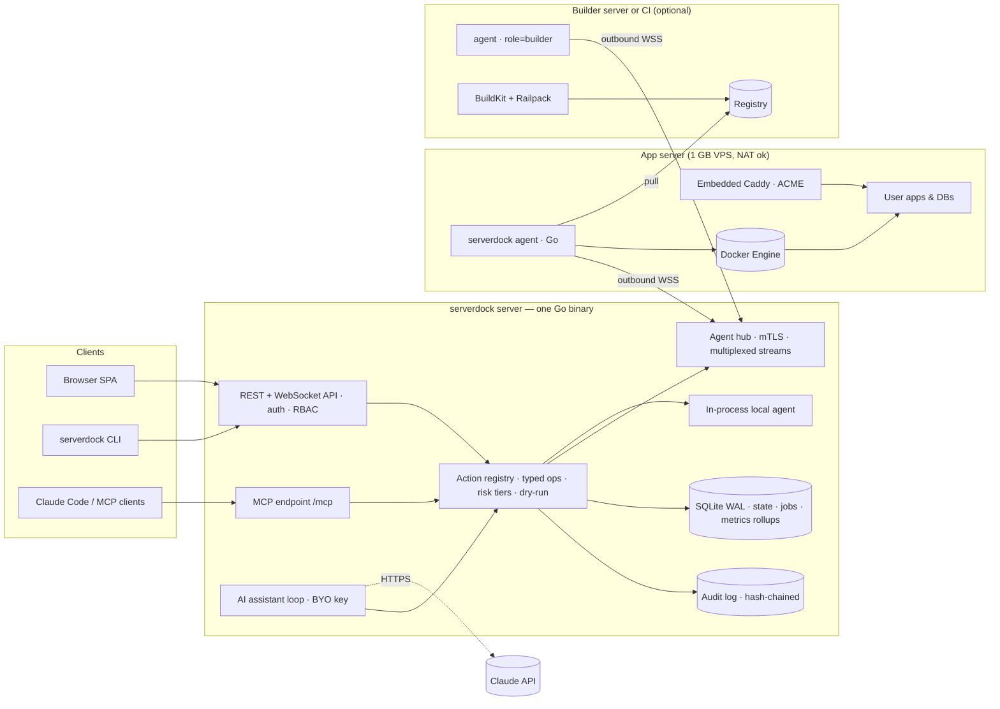

# ServerDock — Architecture

*Draft 1, 2026-11-20. AI-written from [research/03-architecture-options.md](research/03-architecture-options.md); not yet confirmed by the maintainer. Decisions are recorded in [decisions/](decisions/) (0001–0006 accepted 2026-11-20).*

## Overview



## Key decisions

| Area | Decision | Why |
|---|---|---|
| Language | **Go** for control plane, agent and CLI (ADR 0002) | Embeddable compose-go, BuildKit, Railpack, Caddy/certmagic; static cross-compile; infra contributor pool. Rust saves only ~5–10 MB. |
| Shape | **One binary, modes** `server`, `agent`, CLI. Single node runs the agent in-process. | No separate DB/Redis/websocket containers — the biggest RAM win. |
| Database | **SQLite (WAL)**, pure-Go driver, single writer + read pool; jobs table instead of Redis; optional Litestream to S3. Keep a storage interface for a future Postgres backend. | Few MB vs 30–80 MB for Postgres + Redis. Write volume is low. |
| Transport | **Agent dials out** over TLS (WebSocket), multiplexed streams (yamux). One-time enrollment token → Ed25519/mTLS identity. | Works behind NAT/CGNAT, no inbound ports, no SSH keys stored (ADR 0003). |
| Operations | Every agent RPC is a **typed operation** (`ComposeUp{stack,rev}`, `ContainerRestart{id}`), executed via the Docker API. Exec only with argv arrays, never `sh -c`. | Removes the command-injection class behind most Coolify/Dokploy CVEs. |
| Proxy | **Caddy embedded** in the agent, configured with full JSON from desired state; on-demand TLS gated by our DB. Fallback: Caddy container via Unix-socket admin API. | ~20–40 MB vs Traefik ~80–120 MB; atomic reloads; no labels (ADR 0004). |
| Builds | Dockerfile, Compose, **Railpack** on BuildKit. Default: builder server or CI; local builds capped by cgroup. BuildKit runs only during builds. | Builds must never OOM a small app server. Nixpacks deprecated; CNB too heavy. |
| Metrics | Read **cgroup v2 + /proc** directly every 15 s; rollups in SQLite (15 s/24 h → 1 min/7 d → 10 min/30 d → 1 h/1 y). | `docker stats` polling caused Dokploy's CPU storms. |
| Logs | Docker `local` log driver with rotation as the source of truth; stream only while subscribed, always cancel; search with grep on the agent. | No Loki; no orphaned `docker logs` processes. |
| Events | Subscribe to the **Docker events API** for state changes instead of polling. | Idle CPU ≈ 0. |
| Frontend | **SvelteKit static SPA** embedded with `embed.FS`; uPlot charts; xterm.js terminal; REST typed from OpenAPI + one WebSocket. English only. | Small bundle, no server RAM cost (ADR 0005). |
| AI | One action registry shared by UI/REST/CLI/assistant/MCP. Risk tiers `read` / `mutate` / `destructive`; server-enforced approvals; secret redaction; Anthropic Go SDK; zero idle cost. | AI can never exceed the caller's permissions. |

## Core concepts (data model sketch)

- **Server** — a host running an agent (local or remote); roles: `app`, `builder`, `edge`.
- **Project** → **Environment** → **Service** (app from image/git, Compose stack, or database).
- **Deploy** — immutable record: source revision, built image digest, resolved env (encrypted), compose, routes, health result, actor. Rollback = redeploy an earlier Deploy.
- **Domain** — host name → service port, TLS state, diagnostics.
- **Backup** / **BackupRun** — schedule, target, result, restore-test result.
- **Secret** — encrypted value; reveal is an audited action.
- **Action** — registry entry: name, JSON schema, risk tier, required scope, `dryRun()`, `execute()`.
- **AuditEntry** — actor (user, token, AI session), action, args (redacted), dry-run, approver, result, prev-hash.
- **Job** — durable queued work with lock key (per service/server), attempts, cancellation.

## Deploy flow (single node, git source)

1. Webhook arrives → signature verified → Job queued (superseded jobs for the same service are cancelled).
2. Clone into a sandbox dir (refuse symlinks escaping the repo) → build with Railpack/Dockerfile under cgroup caps, or hand off to a builder.
3. Compose/service spec passes **policy check** (no `privileged`, host pid/network, docker.sock or `/` mounts, devices — unless the admin allows it, audited).
4. Start the new container(s) beside the old ones → health gate (HTTP/TCP/command) with timeout.
5. Healthy → switch Caddy upstream atomically → stop old containers after a drain period. Unhealthy → remove the candidate, keep the old version running, report with the log tail.
6. Record Deploy, update commit status, notify.

## Deploy strategies

- **Blue-green** (default for stateless): start beside, health gate, switch, drain connections, graceful stop timeout.
- **Stop-first** (chosen automatically when a writable volume is attached, e.g. databases, SQLite apps, uploads): show a maintenance page, stop old, start new, health gate; on failure restart the old one. Never two writers on one volume.
- **Release phase** (optional): a one-off container on the new image runs migrations before either strategy; failure aborts the deploy.
- Logs of the last N deploys are kept as compressed files on the agent (disk-capped) so removing an old container never loses its logs.

## Runtime compatibility

- Negotiate the Docker API version; publish the supported Docker range; warn when the host's Docker version changes; Docker release candidates run in CI.
- Keep a container-runtime interface so rootless Docker / Podman can be added later (Phase 5).
- Build for the target server's architecture (amd64/arm64).
- IPv6 everywhere: proxy, networks, agent dial-out, DNS diagnostics.

## Failure-handling rules

- Every long operation is a Job with a lock key, timeout and cancellation; restart-safe (resume or clean rollback on boot via reconciler).
- A reconciler compares desired state (DB) with actual state (Docker labels `serverdock.*`) and reports drift; it only removes resources it owns (labelled by deploy attempt).
- Agent disconnect: operations in flight are marked `unknown` until the agent reports back; agent buffers metrics in a ring buffer.
- Version skew: control plane supports agent N-1; agents self-update from the control plane, signature-checked.

## Footprint budget

These are **hard budgets**, measured by `serverdock bench` in CI on a 1 vCPU / 1 GB VM. A PR that exceeds them needs a written reason and `footprint` agent review.

| Component | Idle RSS | Idle CPU |
|---|---|---|
| Control plane (API, hub, scheduler, SQLite, SPA) | ≤ 40 MB | < 0.5% |
| In-process local agent | + ≤ 8 MB | — |
| Remote agent | ≤ 20 MB | < 0.3% |
| Embedded Caddy | + ≤ 30 MB | — |
| **Single node total** | **≤ 80 MB** | **< 1%** |
| **Remote node total (agent + proxy)** | **≤ 50 MB** | **< 0.5%** |
| Binary size (server, compressed) | ≤ 40 MB | |
| SPA first load (gzip) | ≤ 250 KB JS | |

Extra containers ServerDock adds to a managed server: **zero** (agent and proxy in one process), or one if the user chooses the Caddy-container fallback.

## Security model (summary)

Full threat model: [security.md](security.md).

- Agent socket access to Docker is root-equivalent, so the agent has **no listening ports**; only outbound to the control plane.
- Panel binds to localhost behind the embedded proxy; first run needs the console setup token.
- Secrets encrypted with a key kept outside the DB file; the key/data pair is shown to the user to back up.
- Auth: sessions + scoped API tokens; TOTP/passkeys; fresh 2FA for terminal, secret reveal, destructive actions; sessions revoked on password/2FA change.
- WebSocket/terminal/MCP routes use the same authz as REST; an RBAC route-matrix test runs in CI.
- Signed releases; SBOM; private vulnerability reporting.

## Repository layout (planned)

```
cmd/serverdock/        main: server | agent | cli subcommands
internal/actions/      action registry (shared by API, MCP, AI)
internal/agent/        agent runtime, docker ops, caddy, metrics, logs
internal/hub/          agent connections, streams
internal/api/          REST + WebSocket handlers, auth, RBAC
internal/mcp/          MCP server
internal/ai/           assistant loop, redaction, approvals
internal/store/        SQLite, migrations, jobs
internal/deploy/       pipeline, health gate, rollback, reconciler
internal/build/        railpack/buildkit, builder selection
web/                   SvelteKit SPA (embedded at build time)
templates/             one-click app catalog + CI tests
docs/                  vision, features, architecture, roadmap, research, plans, decisions
```
