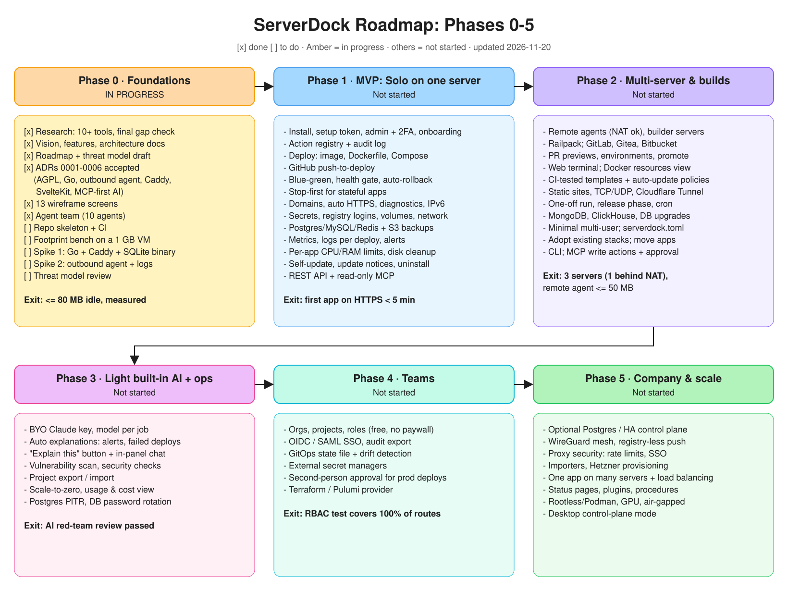

# ServerDock — Roadmap

*Draft 1, 2026-11-20. AI-written; not yet confirmed by the maintainer. No dates yet — each phase ends with an exit check, not a deadline. Feature details in [features.md](features.md).*

Editable source: [diagrams/roadmap-phases.excalidraw](diagrams/roadmap-phases.excalidraw) (open at excalidraw.com). Keep the chart in sync when phases change.

## Phase 0 — Foundations

Goal: decisions locked and a skeleton that proves the footprint.

- [ ] Confirm vision, features, architecture (maintainer review of these docs) — **carried over to Phase 1: due before M3a** ([plan 0002](plans/0002-phase-1-mvp-solo.md), Part D)
- [x] Accept ADRs 0001–0006 (AGPL-3.0, Go, outbound agent, embedded Caddy, SvelteKit, MCP-first AI) — accepted by the maintainer 2026-11-20
- [x] ADR 0007 (no telemetry by default) — accepted by the maintainer 2026-11-20
- [x] ADR 0008 (footprint gates on deployed shapes; slim agent in Phase 2) — accepted by the maintainer 2026-11-20
- [x] Research, feature list, wireframes (13 screens), phase chart
- [x] Repo skeleton (`cmd/`, `internal/`, `web/`), Go module, lint, CI (test, vet, govulncheck, build for amd64/arm64) — ran on GitHub in PR #1 ([run 44715013248](https://github.com/Docker-Hunterpedia/serverdock/actions/runs/44715013248))
- [x] Bench harness (`bench/run.sh`, `measure.sh`, `report`) + CI bench job reporting idle RSS/CPU — implemented as scripts rather than a `serverdock bench` subcommand; CI job ran in PR #1 ([run 44715013248](https://github.com/Docker-Hunterpedia/serverdock/actions/runs/44715013248))
- [x] **Spike 1:** Go binary with embedded Caddy + SQLite + empty SPA → measure idle RSS — implemented and tested; only a local informational measurement so far ([05-phase0-measurements.md](research/05-phase0-measurements.md))
- [x] **Spike 2:** agent dials out over WebSocket with yamux, survives reconnects, streams container logs on demand — implemented and tested (plain `ws://`; TLS/mTLS come in Phase 1/2)
- [x] `docs/security.md` threat model reviewed by the `security` agent — carried over to Phase 1 and done in M1 after step 6 (Draft 2, 2026-11-20); its M1 findings (G1, G3 part, G12, and the review fixes) are built and recorded under "M1 close-out status" in [security.md](security.md)

**Exit:** both spikes measured under budget (≤ 80 MB single node). If not, revisit ADR 0004 (Caddy container fallback).
**Result (2026-11-20):** met in CI: single node 47.6 MB, remote node 44.1 MB, 0% idle CPU ([research/05](research/05-phase0-measurements.md)). The real 1 GB VPS run is deferred to the Phase 1 exit.

## Phase 1 — MVP: "Solo on one server"

Goal: a solo dev can replace Coolify/Dokploy on one 1 GB VPS.

- [x] Setup token, admin + TOTP with recovery codes, first-run onboarding UI over HTTPS — built in M2 ([plan 0003](plans/0003-m2-auth-first-run-spa.md) steps 5–12; tests: `TestFirstRunOverHTTP` in `internal/api/authflow_test.go`, Playwright `web/e2e/setup.spec.ts`; [security.md](security.md#m2-close-out-status))
- [ ] Install script with pre-flight checks (M7a)
- [ ] Signed releases (cosign); `serverdock bench` published with each release
- [x] Action registry (typed ops, risk tiers, audit log) — the base for everything else — built in M1 (`internal/actions`, `internal/audit`, `internal/redact`; policy-table, tamper-detection and sentinel tests; no HTTP route yet, those arrive in M2)
- [ ] Deploy from image, Dockerfile (git), and Compose (policy-checked)
- [ ] GitHub push-to-deploy + generic webhook, commit status
- [ ] Blue-green handover, health gate, automatic rollback, one-click rollback from deploy snapshots; auto-cancel superseded deploys
- [ ] Domains with automatic HTTPS (embedded Caddy) and actionable diagnostics; TLS problems never take a running app down
- [ ] Passkeys for the panel once it has a domain (WebAuthn), with TOTP and recovery codes as fallback (M4)
- [ ] Env vars & secrets (encrypted, audited reveal)
- [ ] Postgres / MySQL / Redis one-click + scheduled S3 backups + restore
- [ ] Metrics (cgroup), live logs, log search, basic alerts; email/webhook/Telegram notifications
- [ ] Local builds with cgroup caps
- [ ] Private registry credentials; persistent volumes; per-project network with service DNS
- [ ] Automatic disk cleanup (old images, build cache) + disk alerts; size-capped BuildKit cache; build concurrency setting
- [ ] Per-app CPU/RAM limits; stop-first strategy for stateful apps; connection draining on blue-green
- [ ] Keep logs of the last N deploys; live build/pull progress; restart and redeploy-without-rebuild; deploy context variables
- [ ] "Update available" notice for app images
- [ ] IPv6 support; Docker API version negotiation + supported Docker range + Docker RC in CI *(negotiation and the Engine 25+ range are built (M1 step 4); IPv6 and the RC CI matrix are not)*
- [x] Token expiry — API tokens require an expiry (default 90 days, at most 365), built in M2 (`TestTokenExpiryDefaultMaximumAndRequired` in `internal/auth/authactions_test.go`; Playwright `web/e2e/security.spec.ts`)
- [ ] `serverdock uninstall`, `start/stop/status`, `doctor --bundle`
- [ ] Docs site with first-deploy guide; in-UI docs links and empty-state hints
- [ ] Self-update with candidate + rollback; ServerDock state backup + rehearse restore
- [x] REST API (OpenAPI) — built in M2: `POST /api/v1/actions/{name}` over the action registry, with a generated OpenAPI 3.1 document ([`docs/api/openapi.json`](api/openapi.json), `make openapi`; `TestOpenAPIGolden`, `TestRESTActionPolicyMatrix` in `internal/api/rest_test.go`)
- [ ] **Read-only MCP endpoint** with scoped `read` tokens and secret redaction (ADR 0006)
- [x] Accessible, phone-usable UI baseline — built in M2: the shell, setup, sign-in, Overview and Settings › Security, WCAG 2.2 AA checked by axe in eight Playwright projects (desktop, 390 px, 320 px, 200% zoom, dark, reduced motion, forced colours, WebKit; `web/e2e/`). The manual screen-reader passes for steps 12 and 13 are the maintainer's, still open
- [ ] Accessible, phone-usable UI for all of the above (each later screen repeats the same bar)

**Exit:** full `bench/run.sh` on a fresh 1 GB VPS (deferred from Phase 0); fresh 1 GB VPS → first git app live on HTTPS in < 5 min; idle under the ADR 0011 ceiling (≤ 200 MB; tripwire 80 MB) / < 1% CPU published; security + accessibility reviews passed; dogfooded on our own apps for 2 weeks.

## Phase 2 — Multi-server & builds

- [ ] Remote agent (outbound, enrollment token, mTLS), SSH-assisted one-time install
- [ ] Slim agent build (no SQLite/SPA/control plane); scenario 3 gate ≤ 20 MB, hard fail 25 (ADR 0008)
- [ ] Builder servers; CI build mode (generated GitHub Actions)
- [ ] Railpack zero-config builds
- [ ] GitLab, Gitea, Bitbucket; PR previews incl. Compose; Compose diff review
- [ ] Environments, cron jobs, pre/post-deploy commands
- [ ] Move/copy app between servers
- [ ] Web terminal (container; host shell behind 2FA + hostname confirmation)
- [ ] Template catalog with CI-tested templates
- [ ] Volume backups + automated restore tests
- [ ] Wildcard domains (DNS-01), redirects, basic auth, maintenance mode, Cloudflare awareness
- [ ] CLI; request-ID tracing
- [ ] **MCP write actions**: dry-run → `pending_approval` → approve in the panel → execute; destructive actions need typed confirmation (ADR 0006)
- [ ] MCP investigation tools (failing services, explain deploy failure, logs around, what changed, trace request); Claude Code skills
- [ ] Passkeys; more notification channels
- [ ] Docker resources view per server: containers, images, volumes, networks (incl. unmanaged), prune with preview
- [ ] Web + worker processes from one repo; replicas on one server
- [ ] Deploy from a local folder (`serverdock up`)
- [ ] Cloudflare Tunnel for servers with no public IP
- [ ] MongoDB and ClickHouse
- [ ] App/template auto-update policies (through health gate + rollback, backup first)
- [ ] Minimal multi-user (admin + member)
- [ ] Per-repo `serverdock.toml`; adopt existing Compose stacks/containers; import `.env`; mounted config files
- [ ] One-off run commands; release phase semantics for migrations
- [ ] Static sites served by Caddy; TCP/UDP exposure; external DB access with TLS + IP allowlist
- [ ] Promote staging → prod; clone environment; preview lifecycle (auto-delete, cap, DB seed, fork approval)
- [ ] DB major-version upgrade; optional PgBouncer; backups to local disk / SFTP
- [ ] Build for target architecture (arm64); templates tested on arm64
- [ ] Master key re-key; agent cert renewal/revocation; BYO TLS certs; per-project alert routing
- [ ] Compose conformance test suite

**Exit:** 3 servers (one behind NAT) managed from one panel; remote node ≤ 100 MB with proxy (tripwire 50 MB, ADR 0011); template CI green.

## Phase 3 — Light built-in AI

Only what MCP can't do (ADR 0006); a small loop over the same action registry.

- [ ] BYO Claude API key (encrypted), per-feature model choice (Haiku/Sonnet/Opus/Fable 5.x), usage/cost display
- [ ] Automatic explanations of alerts and failed deploys
- [ ] "Explain this" button on logs, deploys and alerts
- [ ] In-panel chat for users without an AI client (same approval flow as MCP)
- [ ] Prompt-injection hardening review

Also in Phase 3 (non-AI):

- [ ] Image vulnerability scanning (opt-in, on the builder)
- [ ] Project export/import between ServerDock installs
- [ ] Server security checks: pending updates, SSH password login, open ports, firewall
- [ ] Scale-to-zero for idle apps and previews; usage & cost view
- [ ] Postgres point-in-time recovery; one-click DB password rotation
- [ ] Azure DevOps, Codeberg sources
- [ ] Import Coolify/Dokploy templates; Prometheus/OTLP export; request analytics
- [ ] Volume file browser; registry cache; optional built-in registry (Zot)

**Exit:** red-team review of AI tools by `security` agent; assistant resolves a set of scripted incident scenarios correctly.

## Phase 4 — Teams

- [ ] Organizations, projects, roles, per-project access (free)
- [ ] OIDC/SAML SSO; audit export
- [ ] GitOps platform state file with drift detection
- [ ] External secret managers
- [ ] Required second-person approval for prod deploys; Terraform/Pulumi provider

**Exit:** RBAC route-matrix test covers 100% of routes incl. WebSocket/MCP.

## Phase 5 — Company & scale

- [ ] Optional Postgres backend / HA control plane
- [ ] WireGuard private mesh between servers; registry-less layer push
- [ ] Proxy security (rate limits, geo/IP rules, SSO forward-auth)
- [ ] Importers (Coolify, Dokploy, CapRover); cloud provisioning (Hetzner)
- [ ] Uptime checks & status pages; plugins; desktop/laptop control-plane mode
- [ ] Scripted multi-step actions (procedures) on the action registry
- [ ] One app across several servers with load balancing
- [ ] "Deploy to ServerDock" shareable links
- [ ] Rootless Docker / Podman; GPU containers; air-gapped install bundle

## Release & quality gates (every phase)

- Plans in `docs/plans/` approved by `reviewer` before implementation.
- `footprint` check on every release; budget regressions block release.
- `security` review on auth, secrets, agent channel, terminal, AI tools, input handling.
- `accessibility` review on every UI change.
- Changelog with honest "breaking changes" section; upgrades tested N-1 → N **and N-5 → N** in CI; Docker release candidates in the CI matrix.
- Updates never overwrite user config, never report success on failure, and show release notes first. No upsell banners.
