# Wireframes

Grayscale on purpose: layout and flows first, visual style later. They show the target product across all phases. Items that come after Phase 1 are labelled with their phase. Screen notes: [../ui.md](../ui.md).

Regenerate the PNGs from the sources with `tools/export.sh src` (needs Google Chrome). `src/` holds each screen's `.dc.html` file and the canvas layout (`canvas.json`).

## 1 · Overview
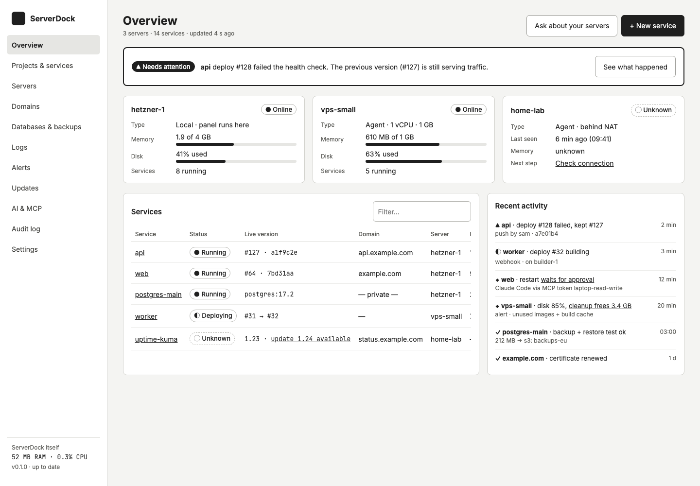

## 2 · Service detail
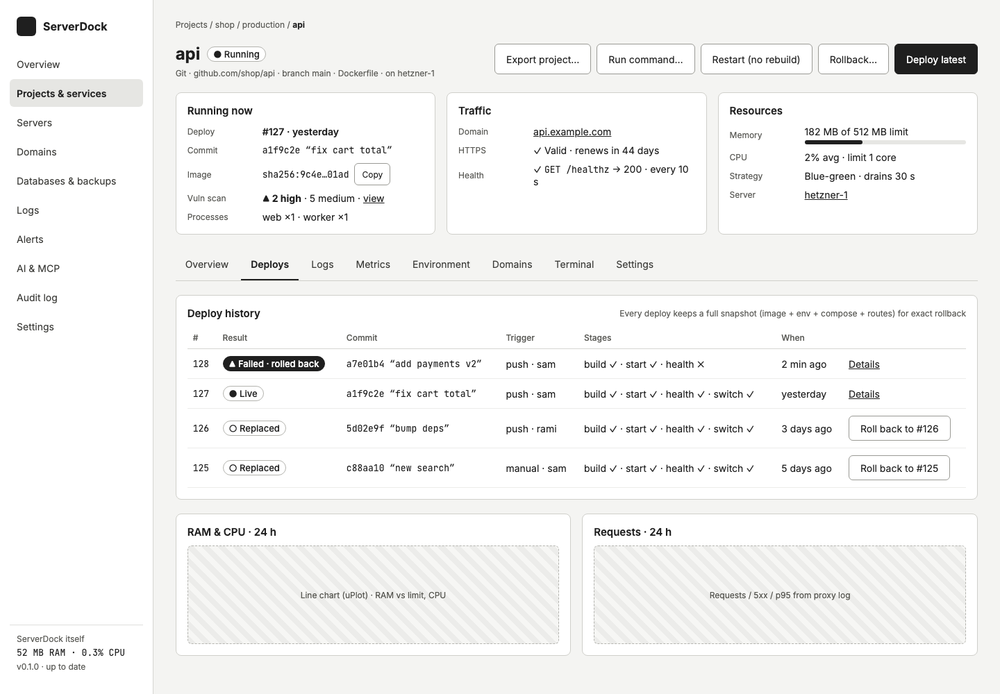

## 3 · Failed deploy, auto-rolled back
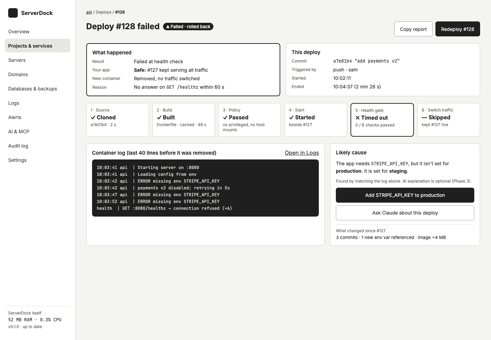

## 4 · Phone: incident
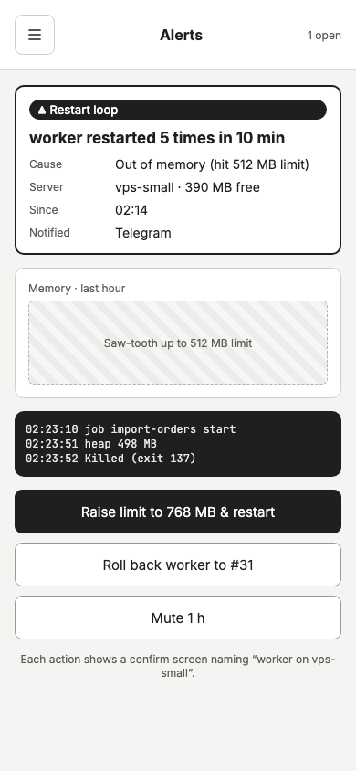

## 5 · New service
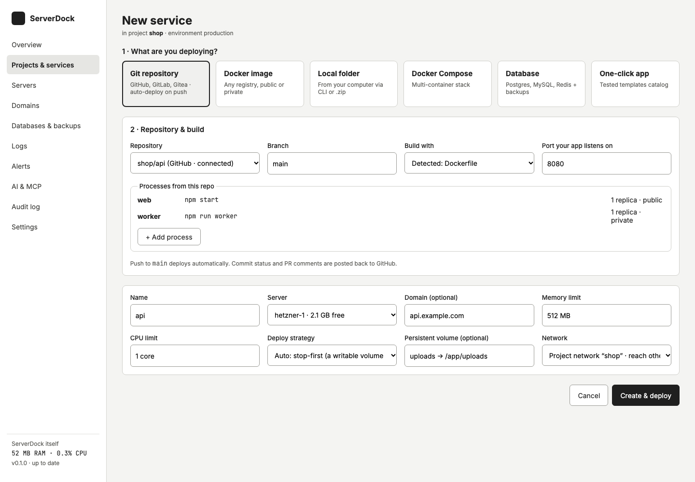

## 6 · Servers & add server
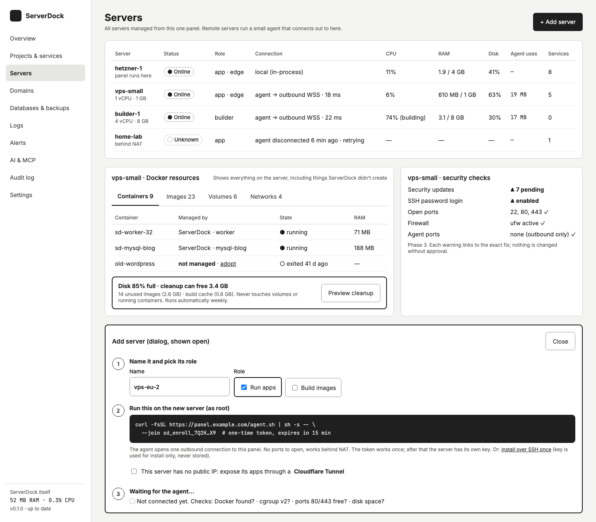

## 7 · Domains & diagnostics
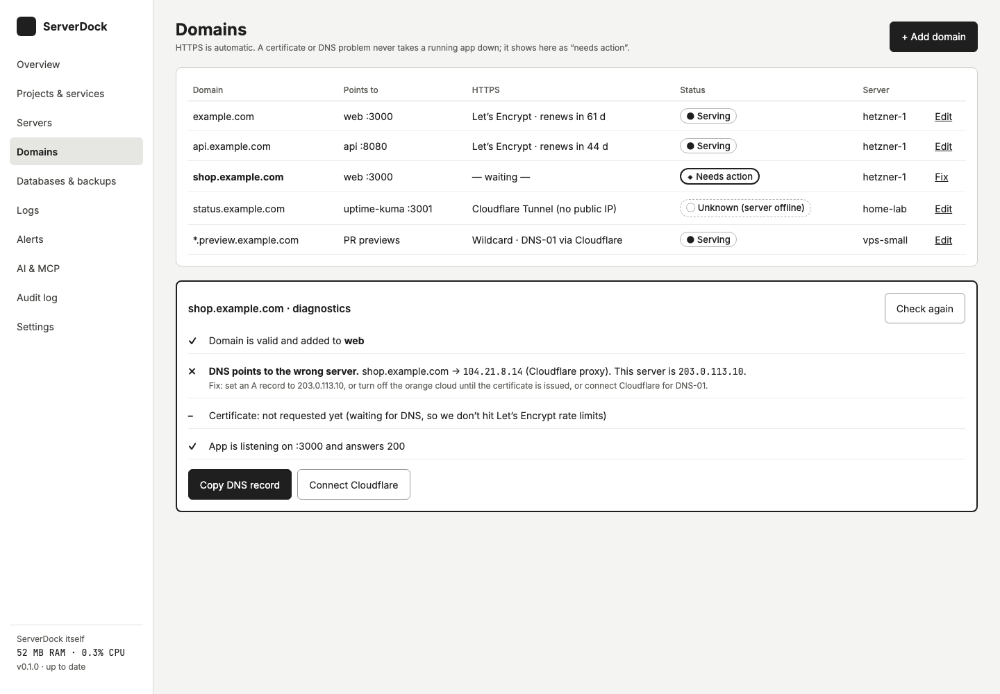

## 8 · Logs
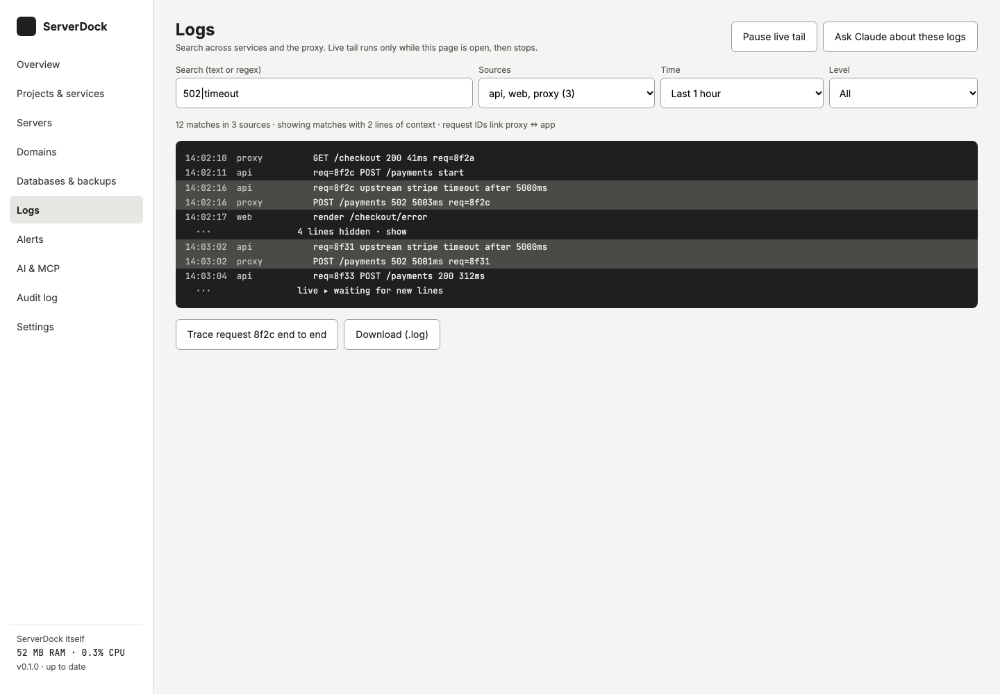

## 9 · Databases & backups
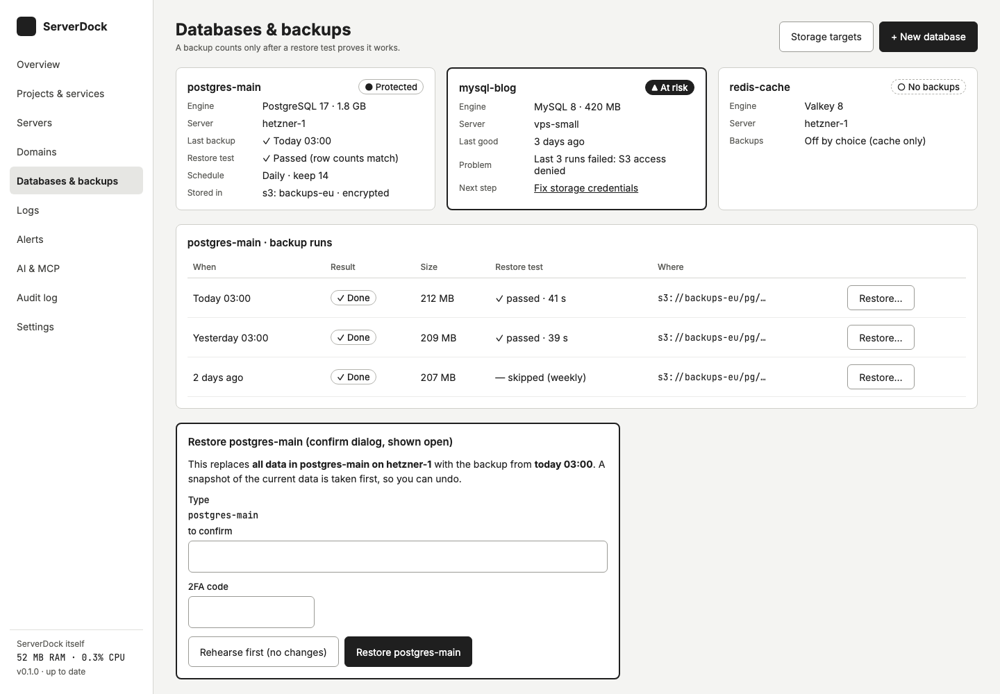

## 10 · AI & MCP approvals
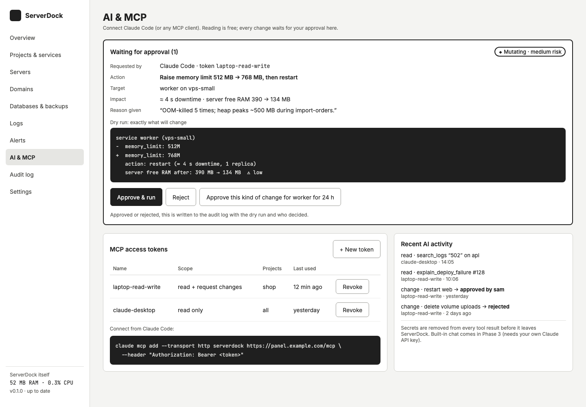

## 11 · First run / onboarding
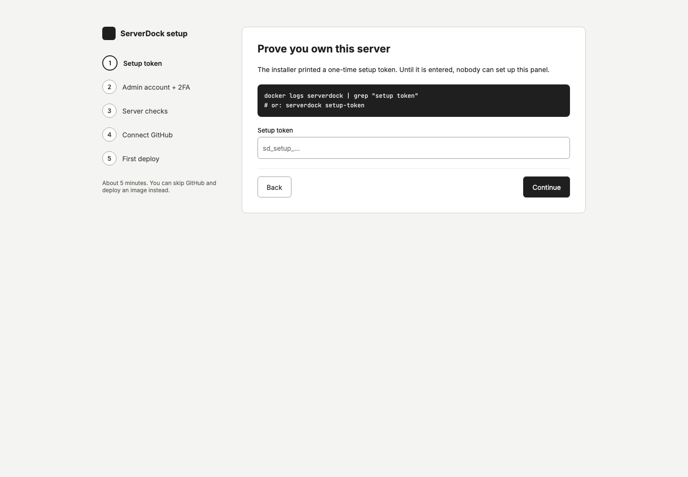

## 12 · Updates
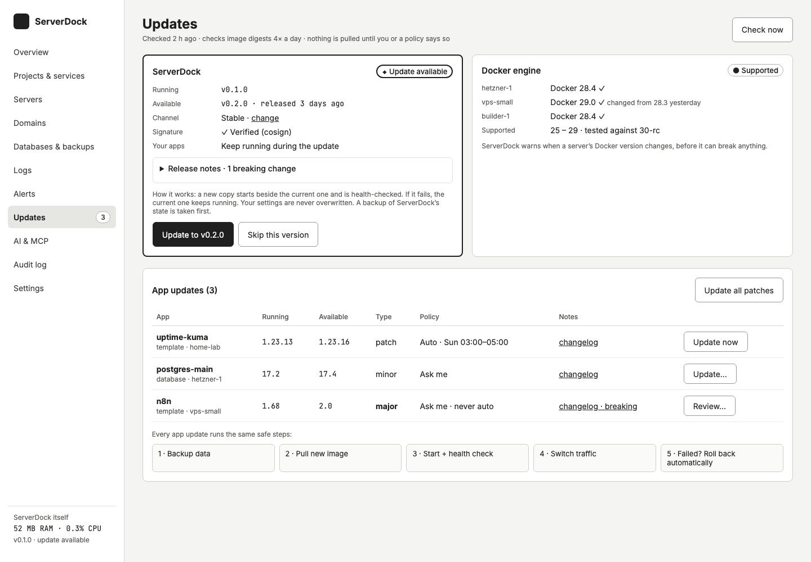

## 13 · Settings
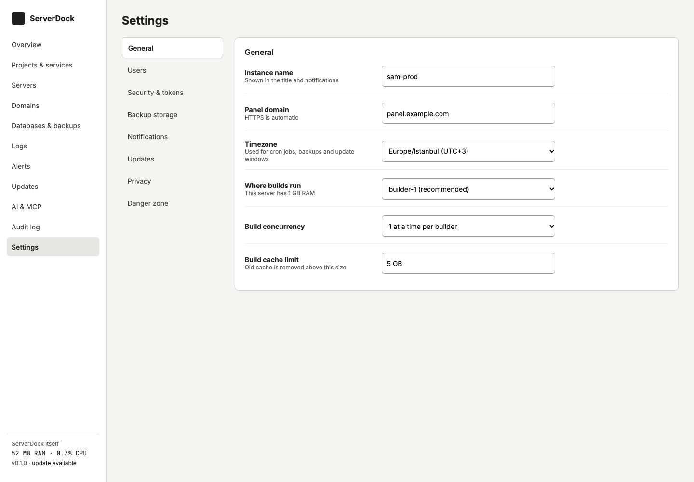
